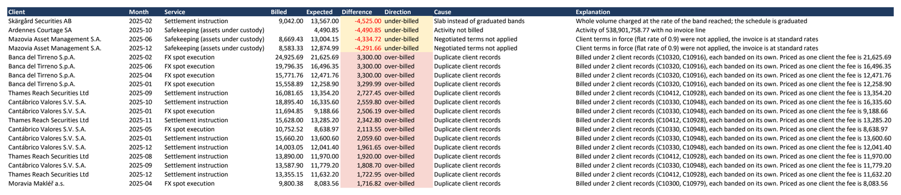
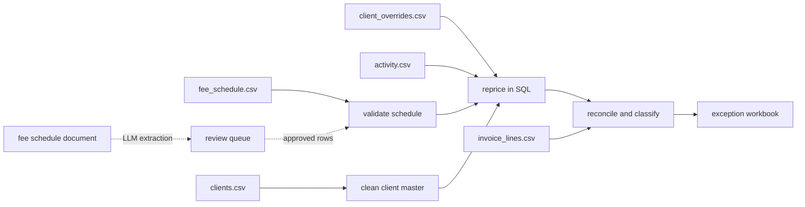
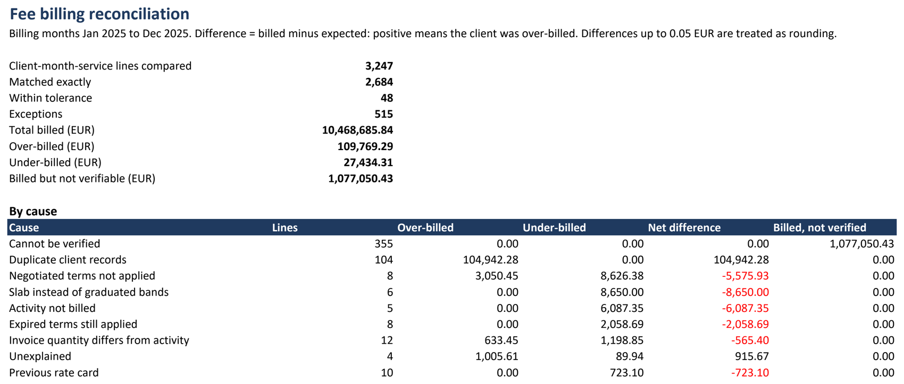

# Fee Billing Reconciliation

A billing control for tiered fee schedules. It reprices what each client should have been charged from the tariff and their activity, compares that with what the billing system invoiced, and explains every difference.



The setting is a securities-services provider billing institutional clients monthly for settlement, custody, FX, corporate actions and messaging. Fees depend on volume bands, the tariff changes during the year, and some clients have negotiated terms. The data is synthetic: a generator writes the inputs and a simulated billing system that makes specific, known mistakes.

On the generated year (3,247 client-month-service lines, EUR 10.5 million billed) the control finds EUR 109,769 over-billed and EUR 27,434 under-billed, and EUR 1.08 million that cannot be verified because the fee schedule itself is defective.

## How it works



| Step | Where | What happens |
|---|---|---|
| Land and type | `sql/01`, `sql/02` | Files are loaded as text and cast without failing on bad values |
| Validate the schedule | `sql/03` | Overlapping dates, date gaps, missing tiers, overlapping tiers |
| Clean the client master | `sql/04` | LEI check digits, duplicate records mapped to one surviving client |
| Reprice | `sql/05`, `sql/06` | Fee functions for tiers, volume bands and client overrides |
| Reconcile | `sql/07` | Billed against expected, with a cause for every difference |
| Report | `src/feerecon/workbook.py` | Excel workbook listing each discrepancy |

## Inputs

| File | Rows | Content |
|---|---:|---|
| `clients.csv` | 66 | Client master with LEI, country, segment |
| `fee_schedule.csv` | 24 | Published tariff: one row per band of a schedule version |
| `client_overrides.csv` | 15 | Negotiated discounts and flat rates with validity dates |
| `activity.csv` | 19,901 | Billable activity per client, service and day for 2025 |
| `invoice_lines.csv` | 3,527 | What the billing system charged per client, month and service |

`data/raw/planted_issues.json` lists every problem the generator put in. The tests compare the control's findings against that list as sets, so a missed error and a false alarm both fail.

## Fee schedule validation

A schedule version is a service plus the date it comes into force. The checks look between versions (validity dates) and inside a version (bands).

| Finding | Service | Consequence |
|---|---|---|
| Date gap | Corporate actions | No rate in force in April 2025 |
| Date overlap | Messaging | Old rate never end-dated, two rates in force from October 2025 |
| Missing tier | FX | No band between EUR 10m and EUR 50m from July 2025 |
| Overlapping tiers | Settlement | 2026 card: third band starts inside the second |

Each finding carries the billing months it affects. Lines that fall into one are reported as "cannot be verified" instead of being priced with a guess: 355 lines, EUR 1.08 million billed.

## Client master

- **LEI check digits** are validated in SQL with ISO 7064 MOD 97-10: 3 records have check digits that do not match (typing errors), 1 has the wrong length, 3 have no LEI. An LEI written in lower case or with spaces is normalised, not flagged.
- **Duplicates**: records sharing a valid LEI are the same legal entity and are merged into the one onboarded first (5 records). Records that only share a name and country are listed as candidates and merged only when a decision is on file (1 record).

66 records become 60 clients. Activity and invoices of a merged record are attributed to the surviving client.

## Repricing

Two SQL functions do the pricing:

- `pricing.standard_fee(service, month, measure)` prices a monthly volume from the schedule version in force. **Graduated** bands charge each band at its own rate for the part of the volume inside it; **slab** bands charge the whole volume at the rate of the band reached. Rates are per item, in basis points, or in annual basis points charged monthly.
- `pricing.client_fee(client, service, month, measure)` applies the client's negotiated terms on top (a percentage discount, or a flat rate that replaces the bands) and rounds to cents.

A rate applies to a billing month only if it is in force for the whole month. When the schedule cannot price a volume (no version, two versions, a gap or overlap below the volume) the functions return NULL, which the reconciliation treats as a finding and never as zero.

The same arithmetic exists a second time in Python (`src/feerecon/pricing.py`). The tests run hand-calculated cases against both and compare the two on all 3,200 repriced lines.

## Reconciliation

Differences up to EUR 0.05 are rounding. Anything larger gets a cause, found by repricing under the mistakes a billing system typically makes and checking which variant reproduces the invoiced amount:

| Cause | Lines | Over-billed | Under-billed |
|---|---:|---:|---:|
| Duplicate client records, each banded on its own | 104 | 104,942.28 | 0.00 |
| Negotiated terms not applied | 8 | 3,050.45 | 8,626.38 |
| Slab instead of graduated bands | 6 | 0.00 | 8,650.00 |
| Activity not billed | 5 | 0.00 | 6,087.35 |
| Expired terms still applied | 8 | 0.00 | 2,058.69 |
| Invoice quantity differs from activity | 12 | 633.45 | 1,198.85 |
| Unexplained | 4 | 1,005.61 | 89.94 |
| Previous rate card | 10 | 0.00 | 723.10 |
| Billed without activity | 3 | 137.50 | 0.00 |

What no variant reproduces stays "unexplained" instead of being forced into a category.

The largest finding comes from the master data, not from pricing: a client that exists twice has its volume split over two records, so less of it reaches the cheaper bands.

## Exception workbook

`python -m feerecon excel` writes `reports/fee_billing_exceptions.xlsx`:

- **Summary**: totals and the breakdown by cause
- **Exceptions**: every discrepancy with client, month, service, billed and expected amount, difference, cause and a one-line explanation
- **By client**, **Fee schedule issues**, **Client master issues**, **Causes**



## Loading a fee schedule from its text

New tariffs arrive as documents, and keying them in by hand is where defects like the ones above come from. `python -m feerecon extract docs/tariffs/schedule_of_fees_2026-07.txt` reads a schedule document with an open model served by the Groq API and turns it into tariff rows. Groq's free tier is enough, so the whole project runs without paid services.

The model is used for reading only:

1. **Structured extraction.** The model's answer is forced to be a call of one tool whose JSON schema describes a row, so it cannot answer in any other shape. Pydantic validates the values.
2. **Validation loop.** The rows go through the same gap and overlap rules as the SQL validation, and every row has to quote the document. Rows that fail are sent back with the list of problems, for up to three attempts.
3. **Human review.** Rows land in `pricing.tariff_review`. A row is approved automatically only when the model was confident, the quote is in the document and its version passed the checks. The rest waits: `feerecon review list`, `approve`, `reject`.
4. **Publishing.** `feerecon review publish <document>` is refused while rows are pending, re-checks the approved set, never overwrites an existing version and end-dates the version it replaces.

All fees are still calculated by the SQL functions. Nothing the model returns is used for pricing before it has passed the queue.

`extract` needs a free `GROQ_API_KEY` and the model to use in `FEERECON_MODEL`. With `openai/gpt-oss-120b` the sample schedule comes back as 12 correct rows on the first attempt, in under ten seconds.

The tests need neither key nor model: they drive the loop with a scripted stand-in.

## Run it

Requirements: Python 3.11+ and Docker.

```bash
docker compose up -d                      # PostgreSQL on port 5434
python -m venv .venv
.venv/Scripts/activate                    # source .venv/bin/activate on Linux and macOS
pip install -e ".[excel,extract,dev]"
cp .env.example .env

python -m feerecon run                    # load, validate, reprice, reconcile, print the findings
python -m feerecon excel                  # write the exception workbook
pytest                                    # 122 tests, in their own database (feerecon_test)
```

`python -m feerecon generate` rewrites the inputs. With the default seed it reproduces the committed files byte for byte.

## Layout

```
data/raw/          generated inputs and the list of planted issues
docs/tariffs/      a fee schedule document for the extraction
sql/               numbered scripts: staging, validation, client master, pricing, reconciliation
src/feerecon/      generator, loader, pipeline, workbook, extraction and review
reports/           the built exception workbook
tests/             pytest suite, runs against the docker-compose database
```
